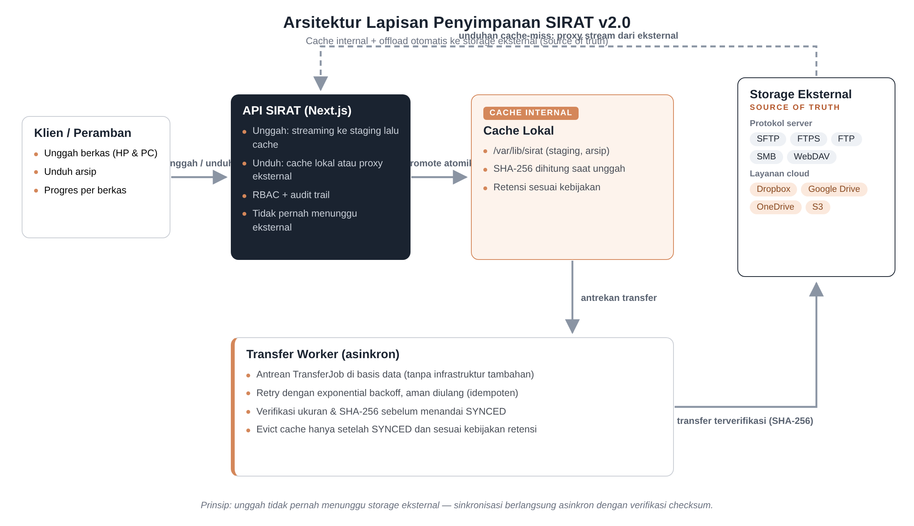

# PRD Penyimpanan Eksternal SIRAT v2.0

**Product Requirements Document — Cache internal dengan offload otomatis ke protokol server dan layanan cloud**

| Atribut | Nilai |
|---|---|
| Aplikasi | SIRAT — Sistem Informasi Registrasi dan Arsip Surat |
| Organisasi | YAPSI Darussalam |
| Versi Dokumen | 1.0 (Draf untuk Reviu) |
| Tanggal | 27 Oktober 2026 |
| Klasifikasi | Internal |
| Basis audit | Kode sumber SIRAT v1.9 (commit `479c9e4`) di produksi |
| Format lain | `PRD-PENYIMPANAN-EKSTERNAL-v2.docx` (formal, 41 halaman) di folder yang sama |

> **Status: PRD tahap persetujuan — belum diimplementasikan.**
> Penyimpanan produksi saat ini sepenuhnya di disk lokal VPS (hasil audit Bab 2).
> Empat keputusan pemilik sistem menunggu persetujuan (Lampiran D).

<strong>Daftar Isi</strong>

- [1. Ringkasan Eksekutif](#1-ringkasan-eksekutif)
- [2. Hasil Audit Kondisi Saat Ini](#2-hasil-audit-kondisi-saat-ini)
  - [2.1 Metode dan Lingkup Audit](#21-metode-dan-lingkup-audit)
  - [2.2 Audit Fitur Unggah Berkas Digital](#22-audit-fitur-unggah-berkas-digital)
  - [2.3 Audit Lapisan Penyimpanan](#23-audit-lapisan-penyimpanan)
  - [2.4 Analisis Kesenjangan terhadap Kebutuhan Baru](#24-analisis-kesenjangan-terhadap-kebutuhan-baru)
- [3. Tujuan dan Ruang Lingkup](#3-tujuan-dan-ruang-lingkup)
  - [3.1 Tujuan Produk](#31-tujuan-produk)
  - [3.2 Non-Tujuan (Luar Ruang Lingkup)](#32-non-tujuan-luar-ruang-lingkup)
  - [3.3 Pemangku Kepentingan dan Dampak bagi Mereka](#33-pemangku-kepentingan-dan-dampak-bagi-mereka)
- [4. Konsep Solusi dan Arsitektur](#4-konsep-solusi-dan-arsitektur)
  - [4.1 Prinsip Desain](#41-prinsip-desain)
  - [4.2 Gambaran Arsitektur](#42-gambaran-arsitektur)
  - [4.3 Siklus Hidup dan Status Berkas](#43-siklus-hidup-dan-status-berkas)
  - [4.4 Matriks Backend yang Didukung](#44-matriks-backend-yang-didukung)
  - [4.5 Alur Unduhan dengan Cache-Miss](#45-alur-unduhan-dengan-cache-miss)
  - [4.6 Kebijakan Cache dan Retensi](#46-kebijakan-cache-dan-retensi)
  - [4.7 Interaksi dengan Fitur Terkait](#47-interaksi-dengan-fitur-terkait)
- [5. Kebutuhan Fungsional](#5-kebutuhan-fungsional)
  - [5.1 Manajemen Backend dan Konfigurasi](#51-manajemen-backend-dan-konfigurasi)
  - [5.2 Transfer dan Sinkronisasi](#52-transfer-dan-sinkronisasi)
  - [5.3 Unduhan, Cache, dan Observabilitas](#53-unduhan-cache-dan-observabilitas)
  - [5.4 Administrasi dan Keamanan](#54-administrasi-dan-keamanan)
- [6. Kebutuhan Non-Fungsional](#6-kebutuhan-non-fungsional)
  - [6.1 Performa dan Skalabilitas](#61-performa-dan-skalabilitas)
  - [6.2 Keandalan dan Ketahanan Kegagalan](#62-keandalan-dan-ketahanan-kegagalan)
  - [6.3 Keamanan](#63-keamanan)
  - [6.4 Auditabilitas dan Kompatibilitas Mundur](#64-auditabilitas-dan-kompatibilitas-mundur)
  - [6.5 Operasional dan Observabilitas](#65-operasional-dan-observabilitas)
- [7. Model Data dan Perubahan Skema](#7-model-data-dan-perubahan-skema)
  - [7.1 Prinsip Perubahan Skema](#71-prinsip-perubahan-skema)
  - [7.2 Tabel StorageBackend (diperluas)](#72-tabel-storagebackend-diperluas)
  - [7.3 Kolom Baru pada ArchiveVersion](#73-kolom-baru-pada-archiveversion)
  - [7.4 Tabel TransferJob (baru)](#74-tabel-transferjob-baru)
  - [7.5 Kebijakan pada AppSetting](#75-kebijakan-pada-appsetting)
  - [7.6 Dampak pada Backup dan Restore](#76-dampak-pada-backup-dan-restore)
- [8. Desain API](#8-desain-api)
  - [8.1 Endpoint Baru](#81-endpoint-baru)
  - [8.2 Kode Kesalahan Baru](#82-kode-kesalahan-baru)
  - [8.3 Catatan Desain Kontrak](#83-catatan-desain-kontrak)
- [9. Desain Antarmuka (UI/UX)](#9-desain-antarmuka-uiux)
  - [9.1 Struktur Menu](#91-struktur-menu)
  - [9.2 Wizard Tambah Backend](#92-wizard-tambah-backend)
  - [9.3 Dasbor Status](#93-dasbor-status)
  - [9.4 Lencana Status pada Detail Surat](#94-lencana-status-pada-detail-surat)
  - [9.5 Prinsip Pengalaman Pengguna](#95-prinsip-pengalaman-pengguna)
- [10. Keamanan dan Kepatuhan](#10-keamanan-dan-kepatuhan)
  - [10.1 Enkripsi Kredensial](#101-enkripsi-kredensial)
  - [10.2 Penyamaran dan Pembatasan Respons](#102-penyamaran-dan-pembatasan-respons)
  - [10.3 Kontrol Akses dan Audit](#103-kontrol-akses-dan-audit)
  - [10.4 Protokol dan Transpor](#104-protokol-dan-transpor)
  - [10.5 Jejak Transaksi dan Batas Log](#105-jejak-transaksi-dan-batas-log)
- [11. Kelayakan Teknis dan Pustaka](#11-kelayakan-teknis-dan-pustaka)
  - [11.1 Peta Pustaka dan Status Pemeliharaan](#111-peta-pustaka-dan-status-pemeliharaan)
  - [11.2 Keputusan Arsitektur: Antrean di Basis Data](#112-keputusan-arsitektur-antrean-di-basis-data)
  - [11.3 Dampak Infrastruktur](#113-dampak-infrastruktur)
- [12. Roadmap Implementasi](#12-roadmap-implementasi)
  - [12.1 Tiga Fase dengan Gerbang Kualitas](#121-tiga-fase-dengan-gerbang-kualitas)
  - [12.2 Urutan Kerja dalam Fase 1](#122-urutan-kerja-dalam-fase-1)
  - [12.3 Urutan Kerja dalam Fase 2 dan Fase 3](#123-urutan-kerja-dalam-fase-2-dan-fase-3)
- [13. Analisis Risiko dan Mitigasi](#13-analisis-risiko-dan-mitigasi)
  - [13.1 Register Risiko](#131-register-risiko)
- [14. Metrik Keberhasilan dan Rencana Pengujian](#14-metrik-keberhasilan-dan-rencana-pengujian)
  - [14.1 Metrik Keberhasilan](#141-metrik-keberhasilan)
  - [14.2 Rencana Pengujian](#142-rencana-pengujian)
  - [14.3 Definisi Selesai](#143-definisi-selesai)
- [15. Lampiran](#15-lampiran)
  - [15.1 Lampiran A - Glosarium](#151-lampiran-a---glosarium)
  - [15.2 Lampiran B - Konfigurasi Lingkungan Baru](#152-lampiran-b---konfigurasi-lingkungan-baru)
  - [15.3 Lampiran C - Pemetaan Kebutuhan Lama ke Baru](#153-lampiran-c---pemetaan-kebutuhan-lama-ke-baru)
  - [15.4 Lampiran D - Keputusan yang Dimintakan](#154-lampiran-d---keputusan-yang-dimintakan)

## 1. Ringkasan Eksekutif

Dokumen ini merupakan Product Requirements Document (PRD) untuk evolusi lapisan penyimpanan arsip digital SIRAT, disusun berdasarkan permintaan pemilik sistem tanggal 27 Oktober 2026 dan hasil audit langsung terhadap kode sumber SIRAT v1.9 (commit 479c9e4) yang berjalan di produksi. Audit dilakukan terhadap dua aspek yang diminta: kesesuaian fitur unggah berkas digital terhadap konsep awal, serta kondisi lapisan penyimpanan (storage) yang digunakan saat ini. PRD ini sengaja disusun sebelum eksekusi agar keputusan arsitektur dapat ditinjau dan disepakati terlebih dahulu, sesuai permintaan eksplisit pemilik sistem.

Hasil audit pada aspek pertama adalah baik: **fitur unggah berkas digital telah sepenuhnya sesuai konsep** yang didefinisikan dalam dokumen SIRAT-PRD dan Blueprint asli. Seluruh kebutuhan FR-014 hingga FR-019 serta NFR-003 terpenuhi, mencakup validasi tipe berkas berbasis magic bytes, sanitasi nama berkas, penolakan path traversal, streaming ke staging dengan rename atomik, versioning arsip, unduhan terotorisasi dengan audit, soft delete dan restore, struktur direktori deterministik dengan manifest, hingga penghitungan SHA-256 dan pemeriksaan integritas. Pengalaman pengguna unggah juga telah ditingkatkan pada v1.7 menjadi adaptif perangkat: ponsel menawarkan kamera, galeri, dan pemindai dokumen, sementara PC membuka file explorer secara langsung, keduanya dengan antrean unggah berurutan dan progres per berkas.

Hasil audit pada aspek kedua menunjukkan kesenjangan yang menjadi pokok PRD ini: **penyimpanan saat ini sepenuhnya berada di disk lokal VPS** pada direktori /var/lib/sirat, dengan satu-satunya adapter yaitu local-disk. Tabel StorageBackend memang telah tersedia di skema basis data sejak awal, tetapi dalam kondisi dorman: nol baris data di produksi, tidak pernah dipakai operasi penyimpanan apa pun, dan hanya ikut terbawa pada proses backup. Konsekuensinya, kebutuhan FR-018 (konfigurasi storage dan uji koneksi oleh admin) hanya terpenuhi sebagian melalui health check internal, tanpa antarmuka konfigurasi, tanpa dukungan protokol jaringan, dan tanpa mekanisme pemindahan berkas. Semua arsip hanya tersedia di satu mesin fisik sehingga menjadi titik tunggal kegagalan bagi keberlangsungan arsip jangka panjang.

PRD ini mengusulkan perubahan model penyimpanan sesuai visi pemilik sistem: **storage internal diturunkan menjadi cache, sementara lokasi utama berkas (source of truth) dipindahkan ke storage eksternal** berupa server protokol (FTP, FTPS, SFTP, SMB/CIFS, WebDAV) maupun layanan cloud (Dropbox, Google Drive, OneDrive, dan penyedia yang kompatibel S3). Pemindahan dilakukan oleh transfer worker secara asinkron dengan verifikasi ukuran dan checksum SHA-256 sebelum sebuah berkas dinyatakan tersinkron, sehingga alur unggah yang sudah berjalan tidak pernah menunggu atau terganggu oleh kondisi jaringan eksternal. Kredensial setiap backend disimpan terenkripsi AES-256-GCM, dan seluruh konfigurasi dilakukan melalui menu Pengaturan baru yang hanya dapat diakses administrator sistem.

Implementasi diusulkan dalam tiga fase tanpa perubahan yang merusak kompatibilitas (backward compatible): fase fondasi (refactor lapisan abstraksi, CRUD backend, enkripsi kredensial, UI dasar), fase protokol server (transfer worker, adapter FTP/FTPS/SFTP/SMB/WebDAV, retensi cache, unduhan proxy), dan fase layanan cloud (Dropbox, Google Drive, OneDrive, S3, mirror multi-target, migrasi massal). Keberhasilan diukur dengan metrik yang jelas, antara lain 100 persen berkas tersinkron ke eksternal dalam waktu p95 15 menit setelah unggah, nol kehilangan data diverifikasi checksum, dan tingkat keberhasilan transfer di atas 99 persen. Bagian akhir dokumen memuat keputusan yang dimintakan kepada pemilik sistem sebelum eksekusi dimulai.

---

## 2. Hasil Audit Kondisi Saat Ini

### 2.1 Metode dan Lingkup Audit

Audit dilakukan pada 27 Oktober 2026 terhadap tiga sumber: kode sumber SIRAT v1.9 pada mirror lokal pengembang (identik dengan commit 479c9e4 yang dideploy di VPS produksi), konfigurasi lingkungan produksi yang dibaca langsung dari VPS, serta dokumen konsep asli SIRAT-PRD.md dan SIRAT-Konsep-Blueprint.md sebagai acuan kesesuaian. Pemeriksaan kode mencakup seluruh jalur unggah dan unduhan berkas: route /api/letters/:id/files, route /api/archive-versions/:id/download, route trash dan restore, modul storage/local-disk.ts, modul storage/magic.ts, endpoint integrity-scan, komponen antarmuka letter-detail.tsx, skema Prisma, dan definisi environment variable.

Pemeriksaan sisi produksi mencakup environment variable aktif (SIRAT_ARCHIVE_ROOT, SIRAT_STAGING_ROOT, SIRAT_BACKUP_ROOT, SIRAT_MAX_FILE_BYTES), isi direktori /var/lib/sirat, kapasitas disk, jumlah baris tabel StorageBackend, serta versi runtime Node.js. Hasilnya: root arsip diarahkan ke /var/lib/sirat/archive (saat ini kosong karena pembersihan total data pada v1.9), partisi utama VPS berukuran 124 GB dengan pemakaian 26 GB, tabel StorageBackend nol baris, dan runtime Node.js v20. Lingkup audit tidak mencakup pengujian beban karena sistem belum memiliki volume arsip produksi yang berarti; kesimpulan kapasitas di bab NFR disampaikan sebagai baseline desain, bukan hasil ukur.

### 2.2 Audit Fitur Unggah Berkas Digital

Kesimpulan audit untuk fitur unggah: **sesuai konsep pada seluruh butir yang diperiksa**. Tabel 1 merangkum pemetaan kebutuhan konsep terhadap bukti implementasi di kode. Tidak ditemukan penyimpangan desain, tidak ada jalur pintas yang melemahkan validasi, dan tidak ada regresi terhadap dokumen konsep asli.

**Tabel 1 - Kepatuhan fitur unggah terhadap konsep SIRAT-PRD dan Blueprint**

| Kebutuhan | Kriteria konsep | Bukti implementasi v1.9 | Status |
| --- | --- | --- | --- |
| FR-014 Unggah arsip | Allowlist tipe berkas, batas ukuran, validasi server, sanitasi nama, tolak path traversal | Streaming ke staging, sniffing magic bytes (PDF/JPEG/PNG/DOCX/XLSX/TXT), kecocokan ekstensi, batas 25 MiB, sanitizeOriginalName, safeJoin guard, rename atomik staging ke objek final | Sesuai |
| FR-015 Versi arsip | Penggantian menghasilkan versi baru dengan metadata lengkap | versionNo naik otomatis, isCurrent dipindah, tiap versi menyimpan ukuran, MIME, SHA-256, uploader, waktu | Sesuai |
| FR-016 Unduhan dan audit | Endpoint terotorisasi, berkas tidak bisa diambil hanya dengan mengetahui path | Cek permission archive.download, filter scope RBAC, header Content-Disposition tersanitasi, event audit archive.download | Sesuai |
| FR-017 Soft delete dan restore | Hapus lunak tidak menghapus objek fisik, restore terkontrol | State ACTIVE/TRASHED pada ArchiveFile, endpoint trash dan restore dengan permission dan audit | Sesuai |
| FR-019 Layout otomatis | Struktur folder deterministik, ID stabil, manifest | Object key {unitKey}/letters/{YYYY}/{MM}/{letterId}/{fileId}/{versionId}/blob, manifest.json per folder surat (best-effort, dapat dibangun ulang dari DB) | Sesuai |
| NFR-003 Integritas berkas | Checksum SHA-256, deteksi hilang atau berubah | SHA-256 dihitung saat streaming, endpoint integrity-scan mendeteksi missing, changed (hash beda), dan orphan | Sesuai |
| Blueprint 16.3 Streaming | Berkas besar di-stream, tidak dimuat ke RAM | streamToStaging membaca body per chunk dengan backpressure write stream | Sesuai |
| UX adaptif perangkat (v1.7) | Ponsel dan PC mendapat alur unggah yang sesuai | Deteksi pointer coarse, menu Sumber berkas (Kamera, Galeri, Pindai) di ponsel, file explorer langsung di PC, antrean berurutan dengan progres XHR per berkas | Sesuai |

Dua hal patut digarisbawahi dari tabel di atas. Pertama, keamanan unggah tidak bergantung pada ekstensi atau Content-Type dari klien, melainkan pada isi berkas itu sendiri melalui pemeriksaan magic bytes, sehingga berkas menyamar ditolak sebelum pernah menyentuh folder arsip. Kedua, metadata setiap versi tersimpan lengkap di basis data sehingga manifest di filesystem bersifat pelengkap yang dapat dibangun ulang kapan pun; desain ini membuat SIRAT tidak pernah kehilangan jejak arsip meskipun isi disk harus direkonstruksi.

### 2.3 Audit Lapisan Penyimpanan

Berbeda dengan fitur unggah, lapisan penyimpanan masih berada pada bentuk paling sederhananya. Seluruh operasi berkas (tulis staging, promote, baca, stat, hash, manifest) dipanggil langsung dari modul local-disk.ts yang mengikat path absolut via environment variable SIRAT_ARCHIVE_ROOT. Tidak ada lapisan abstraksi antarmuka penyimpanan, sehingga route unggah, unduhan, backup, dan integrity scan semuanya terikat langsung pada filesystem lokal. Pendekatan ini cepat dan andal untuk satu mesin, tetapi menutup kemungkinan konfigurasi runtime dan pemindahan lokasi tanpa perubahan kode.

Model StorageBackend memang telah didefinisikan di skema Prisma sejak rilis awal dengan kolom kind, label, rootPath, isActive, dan testStatus, yang menunjukkan arah arsitektur multi-backend memang sudah direncanakan sejak awal. Namun pemeriksaan pemakaian kode menunjukkan tabel ini hanya dirujuk oleh modul backup (collect dan restore) sebagai data yang ikut disertakan, tanpa pernah dipakai dalam operasi penyimpanan nyata. Di produksi tabel tersebut nol baris. Fungsi testStorage yang memenuhi sebagian FR-018 hanya dijalankan oleh endpoint health untuk menguji root lokal, bukan oleh antarmuka admin, dan tidak menguji koneksi jaringan apa pun.

Konsekuensi kondisi ini dirangkum dalam tujuh temuan berikut. Pertama, seluruh arsip hanya hidup di satu disk VPS; kegagalan disk atau penyusupan ke VPS berpotensi menghilangkan arsip permanen. Kedua, tidak ada mekanisme offsite meskipun konsep backup berbasis ZIP telah ada, karena backup pun tersimpan di disk yang sama kecuali dipindahkan manual. Ketiga, kapasitas disk (92 GB tersisa) akan menjadi batas keras pertumbuhan arsip dalam hitungan tahun tergantung volume surat. Keempat, FR-018 belum terpenuhi penuh karena admin tidak dapat mengonfigurasi backend maupun menguji koneksi dari antarmuka. Kelima, tidak ada kredensial terkelola untuk storage jaringan. Keenam, tidak ada kebijakan retensi cache sehingga penggunaan disk hanya tumbuh satu arah. Ketujuh, unduhan gagal total dengan kode FILE_MISSING ketika objek fisik hilang dari disk, tanpa jalur pemulihan otomatis.

### 2.4 Analisis Kesenjangan terhadap Kebutuhan Baru

Permintaan pemilik sistem memperluas arah blueprint asli. Blueprint menargetkan pemilihan satu backend saat instalasi (local disk, SMB yang di-mount, SFTP, atau FTPS), sedangkan kebutuhan baru menghendaki model yang lebih maju: storage internal bekerja sebagai cache, berkas asli otomatis dipindahkan ke tujuan eksternal, dan tujuan tersebut dapat dipilih dari beragam protokol maupun layanan cloud melalui menu pengaturan. Tabel 2 memetakan setiap kesenjangan terhadap bagian PRD yang menjawabnya.

**Tabel 2 - Kesenjangan dan solusi yang diusulkan**

| Kesenjangan | Kondisi saat ini | Solusi pada PRD ini |
| --- | --- | --- |
| Backend tunggal disk lokal | Semua operasi file terikat filesystem lokal melalui local-disk.ts | Lapisan abstraksi StorageAdapter dengan adapter per jenis backend (Bab 4.2) |
| Tanpa konfigurasi runtime | Root path hanya bisa diubah lewat environment variable dan restart layanan | CRUD backend, aktivasi, dan uji koneksi melalui menu Pengaturan (FR-201 sampai FR-204) |
| Tanpa kredensial terkelola | Tidak ada penyimpanan kredensial storage | Penyimpanan terenkripsi AES-256-GCM dengan kunci terpisah dari basis data (FR-203, Bab 10) |
| Tanpa pemindahan berkas | Arsip tidak pernah keluar dari VPS | Transfer worker asinkron dengan verifikasi checksum (FR-206 sampai FR-208) |
| Tanpa kebijakan cache | Disk dipakai tanpa batas waktu | Tiga mode retensi cache dengan evict hanya setelah SYNCED (FR-211, Bab 4.6) |
| Tanpa observabilitas storage | Hanya integrity scan manual | Dasbor status, antrean, riwayat transfer, dan audit (FR-212, FR-213) |
| Unduhan bergantung cache lokal | Objek hilang berarti unduhan gagal permanen | Proxy stream dari eksternal saat cache miss dengan opsi re-cache (FR-210) |

Analisis ini menegaskan bahwa perubahan yang dibutuhkan bersifat aditif: seluruh jalur yang sudah benar (validasi, versioning, audit, layout object key) dipertahankan apa adanya, sementara lapisan baru disisipkan di antara route API dan filesystem. Karena itu risiko regresi dapat ditekan dengan memastikan perilaku default setelah refactor identik dengan v1.9 ketika belum ada backend eksternal yang dikonfigurasi, sebuah jaminan yang dijadikan syarat penerimaan pada fase fondasi.

---

## 3. Tujuan dan Ruang Lingkup

### 3.1 Tujuan Produk

Tujuan dirumuskan sebagai hasil terukur yang harus tercapai setelah seluruh fase selesai, bukan sekadar daftar fitur. Setiap tujuan di bawah ini menjadi dasar kebutuhan fungsional pada Bab 5 dan metrik keberhasilan pada Bab 14.

- **G1 - Konfigurasi multi-backend dari menu Pengaturan:** administrator sistem dapat menambahkan, menguji, mengaktifkan, dan menonaktifkan tujuan penyimpanan eksternal tanpa menyentuh file konfigurasi maupun merestart layanan.
- **G2 - Storage internal menjadi cache:** disk VPS berperan sebagai cache cepat untuk unggah dan unduhan, bukan lokasi akhir arsip; lokasi akhir ditentukan oleh backend eksternal yang aktif.
- **G3 - Offload otomatis terverifikasi:** setiap berkas yang selesai diunggah dipindahkan ke backend eksternal secara otomatis, asinkron, dengan verifikasi ukuran dan SHA-256 sebelum dinyatakan tersinkron.
- **G4 - Unduhan transparan dua arah:** pengguna mengunduh arsip tanpa perlu tahu lokasi fisiknya; ketika cache kosong, sistem menarik berkas dari eksternal dan mengalirkannya sebagai proxy.
- **G5 - Kredensial aman:** seluruh kredensial backend disimpan terenkripsi, tidak pernah ditampilkan kembali dalam bentuk apa pun, dan perubahannya selalu tercatat di audit.
- **G6 - Observabilitas penuh:** status sinkronisasi setiap berkas, kedalaman antrean, tingkat keberhasilan transfer, dan riwayat kegagalan dapat dipantau dari antarmuka.
- **G7 - Kompatibel mundur:** perilaku sistem identik dengan v1.9 ketika belum ada backend eksternal; tidak ada migrasi wajib, tidak ada perubahan API yang merusak klien.

### 3.2 Non-Tujuan (Luar Ruang Lingkup)

Menetapkan batas sama pentingnya dengan menetapkan tujuan. Hal-hal berikut secara sadar tidak termasuk ruang lingkup PRD ini agar fokus eksekusi terjaga dan ekspektasi pemangku kepentingan terkelola. Sebagian merupakan kandidat fase lanjutan yang dapat diprioritaskan setelah model cache-eksternal terbukti stabil berjalan minimal satu siklus penuh.

- Bukan sinkronisasi dua arah: sistem tidak menarik perubahan berkas dari sisi eksternal kembali ke SIRAT; eksternal murni tujuan tulis dan sumber baca.
- Bukan berbagi berkas publik: tidak ada tautan berbagi ke pihak luar; unduhan tetap eksklusif melalui proses login dan izin SIRAT.
- Bukan enkripsi sisi klien atau enkripsi berkas at-rest di eksternal: kerahasiaan mengandalkan keamanan akun backend; enkripsi berkas sebelum dikirim menjadi kandidat fase lanjutan.
- Bukan deduplikasi, OCR, atau pemindaian malware: tetap berstatus fase lanjutan sebagaimana blueprint asli.
- Tidak menggantikan sistem backup ZIP yang sudah ada: backup basis data tetap berjalan; kehadiran storage eksternal justru melengkapi ketahanan arsip.
- Tidak mengubah batas ukuran unggah per berkas (25 MiB) maupun allowlist tipe berkas.

### 3.3 Pemangku Kepentingan dan Dampak bagi Mereka

Ada tiga kelompok pemangku kepentingan yang terdampak langsung. Administrator sistem (peran SYSTEM_ADMIN) mendapat kemampuan baru berupa menu konfigurasi penyimpanan dan tanggung jawab menjaga kredensial tetap valid; beban operasionalnya naik sewaktu migrasi awal namun turun setelah itu karena sinkronisasi berjalan otomatis. Operator dan admin unit (OPERATOR, UNIT_ADMIN) tidak mengalami perubahan alur kerja sama sekali; mereka tetap mengunggah dan mengunduh sebagaimana v1.9, hanya kini melihat status sinkronisasi tambahan pada detail berkas. Pemilik organisasi memperoleh jaminan ketahanan arsip yang jauh lebih kuat karena berkas tidak lagi hidup di satu mesin, dengan konsekuensi keputusan yang perlu diambil: memilih layanan eksternal mana yang akan dipakai beserta kebijakan retensi cache yang diinginkan; keputusan ini dirangkum pada Lampiran D.

---

## 4. Konsep Solusi dan Arsitektur

### 4.1 Prinsip Desain

Enam prinsip berikut menjadi pagar pengambilan keputusan teknis sepanjang implementasi. Setiap keputusan rinci pada bab-bab berikutnya harus dapat dipetakan kembali ke salah satu prinsip ini; usulan yang bertentangan dengan prinsip wajib ditolak atau prinsipnya direvisi secara eksplisit melalui kesepakatan bersama.

- **P1 - Ketersediaan di atas sinkronisasi:** unggah tidak pernah menunggu storage eksternal. Kecepatan dan keberhasilan unggah dijamin oleh cache lokal; sinkronisasi adalah proses latar yang menyusul.
- **P2 - Eksternal adalah sumber kebenaran:** status paling aman bagi sebuah berkas adalah SYNCED (terverifikasi di eksternal); cache lokal boleh kosong kapan pun tanpa mengganggu validitas arsip.
- **P3 - Object key logis dan stabil:** layout direktori deterministik blueprint 16.3 dipertahankan sebagai object key yang sama di semua backend, sehingga berkas dapat dilacak dan dimigrasi lintas backend tanpa kehilangan makna.
- **P4 - Idempoten dan aman diulang:** transfer yang gagal di tengah jalan dapat diulang tanpa menduplikasi atau merusak berkas tujuan; verifikasi checksum menjadi hakim akhir keberhasilan.
- **P5 - Kredensial tidak pernah bocor:** kredensial hanya hidup dalam bentuk terenkripsi di basis data dan bentuk terurai di memori proses sesaat; tidak pernah ditampilkan kembali, tidak masuk log, tidak masuk audit.
- **P6 - Tidak ada penghapusan implisit:** cache hanya boleh dikosongkan setelah berkas bersangkutan SYNCED dan hanya sesuai kebijakan retensi yang secara eksplisit dipilih administrator.

### 4.2 Gambaran Arsitektur

*Gambar 1 - Arsitektur lapisan penyimpanan SIRAT v2.0 (cache internal + offload eksternal)*

Arsitektur menyisipkan empat komponen baru di sekitar jalur yang sudah ada. Pertama, **Storage Abstraction Layer (SAL)**: antarmuka tunggal (put, get stream, stat, delete, test) yang diimplementasikan oleh satu adapter per jenis backend; adapter local menjadi implementasi pertama sehingga seluruh pemanggilan lama cukup dialihkan ke SAL tanpa mengubah semantik. Kedua, **modul cache** yang membungkus penyimpanan lokal dengan root yang sama seperti hari ini (staging dan arsip di /var/lib/sirat) beserta kebijakan retensinya. Ketiga, **transfer worker**: proses di dalam aplikasi yang mengambil pekerjaan dari tabel TransferJob, mengunggah berkas dari cache ke backend aktif melalui SAL, memverifikasi hasilnya, lalu memperbarui status sinkronisasi versi. Keempat, **modul konfigurasi storage** (API dan UI) yang mengelola definisi backend beserta kredensial terenkripsi dan hasil uji koneksi.

Alur unggah berubah minimal: request tetap divalidasi dan di-stream ke staging, dihitung SHA-256, lalu dipromosikan ke cache dan versi ditandai READY persis seperti v1.9. Tambahan satu-satunya adalah pembuatan satu baris TransferJob setelah transaksi READY berhasil. Alur unduhan memperoleh cabang baru: ketika objek ditemukan di cache, unduhan terjadi seketika dari disk (jalur cepat, identik v1.9); ketika tidak ditemukan dan versi berstatus SYNCED atau EXTERNAL_ONLY, unduhan di-proxy dari backend eksternal sambil menawarkan pengisian kembali cache. Dengan dua jalur ini, pengguna akhir tidak pernah menyadari perpindahan lokasi fisik berkas.

Pilihan menggunakan tabel basis data sebagai antrean (bukan message broker seperti Redis atau BullMQ) disengaja: deployment SIRAT berupa satu node Next.js standalone dengan PostgreSQL lokal, dan menambah infrastruktur baru bertentangan dengan prinsip kemudahan operasional yang dipegang sejak awal proyek. Ketahanan worker dicapai lewat desain job yang resumable: ketika layanan direstart, worker memindai pekerjaan berstatus RUNNING yang tertinggal, mengembalikannya ke antrean, dan melanjutkan; tidak ada pekerjaan yang hilang hanya karena proses mati.

### 4.3 Siklus Hidup dan Status Berkas

Status penyimpanan versi arsip dipisahkan dari status kesiapan unduhan yang sudah ada (PENDING, READY, FAILED). Kolom baru syncState menggambarkan posisi berkas relatif terhadap backend eksternal. Pemisahan ini penting agar semantik lama tidak berubah: READY tetap berarti siap diunduh dari cache, terlepas dari posisi sinkronisasinya. Tabel 3 merinci arti dan transisi setiap status.

**Tabel 3 - Status sinkronisasi versi arsip (syncState)**

| Status | Arti | Transisi berikutnya yang mungkin |
| --- | --- | --- |
| LOCAL_ONLY | Tersimpan di cache dan belum pernah diantrekan; terjadi bila backend eksternal belum aktif atau fitur baru saja menyala | QUEUED saat backend diaktifkan atau migrasi dijalankan |
| QUEUED | Ada TransferJob aktif menunggu dieksekusi worker | TRANSFERRING saat worker mengambil job |
| TRANSFERRING | Unggahan ke backend eksternal sedang berlangsung | SYNCED bila verifikasi lolos; QUEUED bila gagal dan masih ada sisa percobaan; FAILED bila percobaan habis |
| SYNCED | Tersimpan dan terverifikasi (ukuran dan SHA-256 identik) di backend aktif; cache boleh dikosongkan sesuai kebijakan | EXTERNAL_ONLY saat cache di-evict |
| EXTERNAL_ONLY | Cache sudah tidak memuat berkas; satu-satunya salinan aktif ada di eksternal | Kembali terisi cache saat diunduh (re-cache opsional); SYNCED bila diunduh dan re-cache selesai |
| FAILED | Melewati jumlah percobaan maksimum; butuh intervensi (perbaiki koneksi atau kredensial lalu jalankan coba ulang) | QUEUED setelah administrator memicu coba ulang |

Dua skenario tepi perlu ditegaskan. Pertama, saat backend eksternal dinonaktifkan sementara, berkas baru kembali berstatus LOCAL_ONLY dan antrean yang tersisa dibekukan, bukan dibatalkan; ketika backend diaktifkan lagi, antrean tersebut dilanjutkan. Kedua, penggantian backend aktif tidak mengubah status berkas yang sudah SYNCED di backend lama; berkas tersebut tetap sah, dan administrator dapat menjalankan migrasi bila ingin memindahkannya ke backend baru (Bab 5, FR-214).

### 4.4 Matriks Backend yang Didukung

Sembilan jenis backend direncanakan dengan penahapan yang mempertimbangkan kematangan pustaka dan kompleksitas autentikasi. Fase 2 menghadirkan protokol server yang bekerja dengan kredensial sederhana (alamat, port, pengguna, kunci atau kata sandi), sedangkan fase 3 menghadirkan layanan cloud yang membutuhkan pendaftaran aplikasi dan alur OAuth. Tabel 4 menjadi acuan lingkup tiap fase sekaligus catatan risiko yang diteruskan ke Bab 13.

**Tabel 4 - Matriks backend, autentikasi, pustaka, dan fase hadir**

| Jenis | Autentikasi | Pustaka rekomendasi | Fase | Catatan |
| --- | --- | --- | --- | --- |
| SFTP | Kata sandi atau kunci publik SSH | ssh2-sftp-client | 2 | Paling diutamakan: terenkripsi menyeluruh; mendukung verifikasi host key |
| FTPS | Kata sandi + TLS eksplisit | basic-ftp | 2 | Andal untuk server lama yang mendukung FTP over TLS |
| FTP | Kata sandi (plaintext) | basic-ftp | 2 | Disediakan atas permintaan dengan peringatan eksplisit di UI; tidak disarankan |
| SMB/CIFS | Pengguna domain atau lokal + share | @marsaud/smb2 (fork terawat) dengan alternatif mount CIFS | 2 | Pustaka SMB di ekosistem Node relatif lemah; lihat analisis Bab 11 |
| WebDAV | Basic atau bearer token | webdav | 2 | Cocok untuk NAS Nextcloud, Synology, dan penyimpanan yang menyediakan WebDAV |
| Dropbox | OAuth 2.0 refresh token | REST API resmi v2 (content-upload) | 3 | Pendaftaran aplikasi di Dropbox App Console; token disimpan terenkripsi |
| Google Drive | Service account atau OAuth 2.0 | googleapis | 3 | Service account disarankan untuk server; folder dibagikan ke alamat service account |
| OneDrive | OAuth 2.0 + Microsoft Graph | graph REST (fetch) | 3 | Memerlukan pendaftaran aplikasi Azure AD; alur device code paling sederhana bagi admin |
| S3-compatible | Access key + secret key | @aws-sdk/client-s3 | 3 | Mencakup Cloudflare R2, Backblaze B2, Wasabi, MinIO, dan penyedia objek lain |

Urutan fase di atas mengikuti dua pertimbangan. Protokol server dikerjakan lebih dulu karena kredensialnya sederhana, dapat diuji dengan server uji yang dibangun sendiri di jaringan lokal, dan langsung menjawab skenario institusi yang sudah memiliki NAS atau server berkas. Layanan cloud menyusul karena menuntut persiapan di luar kode: pendaftaran aplikasi, penyesuaian kebijakan penyedia, dan perputaran token yang harus ditangani dengan aman. Dengan urutan ini, nilai inti (arsip tidak lagi terkunci di VPS) sudah tercapai di fase 2 tanpa menunggu integrasi cloud selesai.

### 4.5 Alur Unduhan dengan Cache-Miss

Endpoint unduhan memperluas logika yang ada tanpa mengubah kontraknya. Pemeriksaan izin, scope, status READY, dan penulisan audit tetap berjalan lebih dulu persis seperti v1.9. Ketika objek ditemukan di cache, berkas dialirkan dari disk dengan header yang sama seperti hari ini. Ketika objek tidak ditemukan dan syncState versi adalah SYNCED atau EXTERNAL_ONLY, endpoint membuka stream dari backend eksternal melalui SAL lalu mengalirkannya ke klien sebagai proxy; header Content-Length dan Content-Type tetap diisi dari metadata basis data agar klien menerima pengalaman yang sama.

Proxy mendukung permintaan rentang (HTTP Range) sejauh backend mendukungnya, sehingga pratinjau PDF besar dan unduhan yang terputus tetap dapat dilanjutkan. Sebagai opsi kebijakan, unduhan cache-miss dapat mengisi kembali cache secara berkelanjutan di latar (re-cache) agar unduhan berikutnya kembali memakai jalur cepat. Ketika kondisi terburuk terjadi (objek tidak ada di cache dan backend eksternal menolak koneksi), endpoint mengembalikan kode STORAGE_UNREACHABLE dengan pesan yang dapat ditindaklanjuti, menggantikan FILE_MISSING yang hari ini berarti kehilangan permanen; perbedaan ini penting karena kegagalan jaringan bersifat sementara sedangkan kehilangan objek bersifat permanen.

### 4.6 Kebijakan Cache dan Retensi

Pengosongan cache diatur oleh satu kebijakan dengan tiga mode yang dipilih administrator di menu Pengaturan. Pemilihan mode adalah keputusan risiko versus hemat disk: semakin agresif mengosongkan cache, semakin besar ketergantungan pada ketersediaan jaringan dan backend eksternal saat mengunduh.

- **SIMPAN_SEMUA (default):** cache tidak pernah dikosongkan otomatis. Mode paling konservatif; unduhan selalu cepat dan sistem tetap berfungsi penuh saat eksternal terputus. Cocok dipakai saat kapasitas disk masih longgar.
- **HAPUS_SETELAH_SINKRON:** berkas dihapus dari cache segera setelah verifikasi SYNCED berhasil. Mode paling hemat disk; disarankan hanya setelah backend eksternal terbukti stabil berminggu-minggu.
- **HAPUS_SETELAH_N_HARI:** berkas dihapus dari cache N hari setelah SYNCED (default 30). Kompromi yang menjaga berkas baru tetap cepat diunduh sambil membatasi pertumbuhan disk jangka panjang.

Pengosongan tidak pernah terjadi pada berkas yang belum SYNCED, pada berkas yang sedang dibaca oleh proses lain (unduhan berjalan atau pembuatan backup), dan pada berkas di trash yang belum melewati kebijakan purge. Sebagai jaring pengaman, dasbor menampilkan penggunaan disk cache dan menampilkan peringatan ketika mencapai ambang yang dapat dikonfigurasi (default 80 persen); pengosongan tidak pernah berjalan otomatis saat pembuatan backup sedang aktif agar arsip backup selalu membaca jalur cepat.

### 4.7 Interaksi dengan Fitur Terkait

**Backup dan restore:** modul backup yang ada tetap membaca berkas dari cache lokal. Bila suatu versi telah ter-evict, proses backup menariknya dulu dari backend eksternal ke staging sebelum memasukkannya ke arsip ZIP; durasi backup bertambah sewajar besarnya berkas yang ditarik, dan hal ini dicatat di metadata backup agar administrator paham penyebabnya. Restore tidak berubah: berkas dikembalikan ke cache lalu diantrekan sinkronisasi seperti unggahan baru. **Trash dan purge:** memindahkan berkas ke trash tetap tidak menyentuh objek fisik; purge permanen (saat diaktifkan di fase lanjutan atau lewat skrip operasional) wajib menyapu cache dan salinan eksternal dalam satu transaksi logis, dan hanya boleh berjalan setelah verifikasi bahwa keduanya memang milik versi tersebut.

**Integrity scan:** pemeriksaan lokal berjalan penuh sebagaimana v1.9 (hilang, berubah, orphan). Untuk sisi eksternal ditambahkan pemeriksaan sampel: setiap eksekusi memeriksa sebagian berkas SYNCED secara bergilir (default 10 persen per eksekusi) dengan membandingkan ukuran dan checksum, sehingga seluruh populasi tercakup dalam beberapa eksekusi tanpa membebani jaringan sekaligus. **Pengalaman unggah v1.7:** tidak ada perubahan apa pun pada antarmuka unggah; satu-satunya tambahan yang terlihat pengguna adalah lencana status sinkronisasi pada daftar berkas di detail surat, yang menjelaskan posisi berkas tanpa istilah teknis yang membingungkan.

---

## 5. Kebutuhan Fungsional

Kebutuhan fungsional diberi nomor FR-201 sampai FR-218 sebagai kelanjutan dari penomoran PRD asli (FR-001 sampai FR-019), sehingga tidak ada tabrakan nomor dengan fitur yang sudah berjalan. Setiap kebutuhan dilengkapi kriteria penerimaan yang menjadi dasar pengujian; sebuah kebutuhan dinyatakan selesai hanya ketika seluruh kriterianya terbukti. Pemetaan terhadap FR lama dijelaskan pada Lampiran C, termasuk penegasan bahwa FR-018 lama dipensiunkan dan digantikan kelompok FR di bab ini.

### 5.1 Manajemen Backend dan Konfigurasi

#### FR-201 - CRUD backend penyimpanan

Administrator dapat membuat, melihat, memperbarui, dan menghapus definisi backend penyimpanan melalui menu Pengaturan. Satu backend didefinisikan oleh jenis (SFTP, FTPS, FTP, SMB, WebDAV, Dropbox, Google Drive, OneDrive, S3-compatible), label unik, parameter koneksi (alamat, port, path awal, dan parameter khusus jenis), serta kredensial. Backend yang sedang aktif tidak dapat dihapus; ia harus dinonaktifkan lebih dulu, dan nonaktifkan backend tidak menghapus berkas yang sudah tersinkron di sana.

1. Membuat backend baru dengan label yang sudah dipakai ditolak dengan pesan yang menyebut label yang bentrok.
2. Daftar backend menampilkan jenis, label, status uji koneksi terakhir, waktu uji, dan status aktif.
3. Mengubah parameter koneksi pada backend aktif ditolak; admin harus menonaktifkan, mengubah, menguji, lalu mengaktifkan kembali.
4. Menghapus backend non-aktif tidak menghapus catatan audit yang merujuk padanya.

#### FR-202 - Uji koneksi

Setiap backend dapat diuji koneksinya dengan satu tombol. Uji koneksi melakukan siklus penuh yang relevan per jenis: membuat koneksi, masuk dengan kredensial, menulis berkas probe kecil ke path tujuan, membacanya kembali, lalu menghapusnya. Hasil (berhasil atau gagal beserta penyebab teknisnya) dan waktu uji tersimpan pada definisi backend dan tampil di daftar backend. Uji koneksi tidak pernah menampilkan kredensial apa pun di respons maupun di log.

1. Uji koneksi pada backend SFTP dengan kredensial salah mengembalikan kegagalan autentikasi dalam waktu kurang dari 15 detik (timeout eksplisit).
2. Uji koneksi sukses meninggalkan path tujuan dalam kondisi bersih (probe terhapus).
3. Hasil uji terakhir tampil pada daftar backend tanpa perlu memuat ulang halaman.
4. Setiap uji koneksi mencatat event audit storage.test dengan hasil dan durasi, tanpa isi kredensial.

#### FR-203 - Kredensial terenkripsi

Kredensial backend disimpan di basis data dalam bentuk tersandi AES-256-GCM dengan kunci yang berasal dari environment variable SIRAT_STORAGE_KEY, terpisah dari kredensial basis data. Nilai kredensial tidak pernah dikembalikan oleh API dalam bentuk apa pun setelah disimpan; antarmuka pengeditan menampilkan placeholder yang menyatakan nilai tersimpan dan hanya mengisi ulang ketika admin mengetik nilai baru. Rotasi kunci enkripsi disediakan sebagai skrip operasional yang mengenkripsi ulang seluruh kredensial.

1. Respons API dan log aplikasi tidak pernah memuat nilai kredensial; pemeriksaan otomatis menegaskan hal ini pada respons create, update, dan test.
2. Salinan basis data tanpa SIRAT_STORAGE_KEY tidak dapat memulihkan kredensial apa pun.
3. Mengubah SIRAT_STORAGE_KEY tanpa menjalankan skrip rotasi membuat seluruh backend gagal uji koneksi dengan pesan yang menunjuk ke prosedur rotasi, bukan error yang membingungkan.
4. Audit mencatat perubahan kredensial tanpa menyebut nilai lama maupun baru.

#### FR-204 - Aktivasi backend tunggal

Pada satu waktu hanya ada satu backend eksternal aktif sebagai tujuan utama transfer. Mengaktifkan backend menuntut uji koneksi terakhir yang berhasil; aktivasi backend yang belum pernah diuji atau terakhir gagal ditolak. Ketika backend baru diaktifkan, berkas yang belum pernah tersinkron tetap diantrekan ke backend baru, sedangkan berkas yang sudah SYNCED di backend lama tetap sah dan tidak dipindahkan otomatis.

1. Aktivasi backend dengan uji koneksi gagal ditolak dengan pesan yang menyarankan uji ulang.
2. Tepat satu baris backend berstatus aktif pada setiap saat; pembacaan daftar menegaskan invariant ini.
3. Menonaktifkan backend membekukan antrean TransferJob yang tersisa tanpa membatalkannya; mengaktifkan kembali melanjutkan antrean.
4. Transisi aktif dan non-aktif tercatat di audit beserta aktornya.

### 5.2 Transfer dan Sinkronisasi

#### FR-205 - Antrean otomatis setelah unggah

Ketika versi arsip mencapai status READY dan terdapat backend aktif, sistem membuat satu TransferJob untuk versi tersebut tanpa perlu pemicu manual. Pekerjaan dibuat setelah transaksi metadata READY berhasil sehingga kegagalan pembuatan pekerjaan tidak pernah meninggalkan versi READY tanpa antrean; kegagalan pembuatan diatasi dengan sapuan berkala yang mendeteksi versi READY dengan syncState LOCAL_ONLY dan backend aktif, lalu mengantrekannya (mekanisme self-healing).

1. Unggah sukses pada sistem dengan backend aktif menghasilkan tepat satu TransferJob untuk versi tersebut.
2. Sapuan self-healing mengantrekan versi READY LOCAL_ONLY yang terlewat, tanpa menduplikasi pekerjaan yang sudah ada.
3. Versi pengganti (versi baru dari berkas sama) diantrekan sebagai pekerjaan terpisah; versi lama yang belum tersinkron tetap diantrekan.

#### FR-206 - Eksekusi worker dengan concurrency terbatas

Transfer worker berjalan di dalam proses aplikasi dan mengeksekusi pekerjaan dengan tingkat paralelisme yang dapat dikonfigurasi (default 2). Worker memilih pekerjaan berstatus QUEUED dengan nextRetryAt yang telah tiba, menandainya RUNNING, mengeksekusi, lalu memperbarui hasilnya. Ketika layanan dimatikan secara sopan, worker menghentikan pekerjaan yang sedang berjalan pada titik aman dan mengembalikannya ke antrean; ketika layanan mati mendadak, sapuan saat boot menemukan pekerjaan RUNNING yang tertinggal dan mengembalikannya ke antrean.

1. Restart layanan di tengah transfer besar tidak menghilangkan pekerjaan; pekerjaan dilanjutkan setelah boot.
2. Batas paralelisme dihormati: tidak pernah ada lebih dari N stream transfer aktif bersamaan.
3. Worker menulis log terstruktur per pekerjaan (mulai, progres, selesai atau gagal) tanpa kredensial.

#### FR-207 - Retry dengan exponential backoff

Pekerjaan yang gagal dijalankan kembali secara otomatis dengan jeda yang bertambah eksponensial (contoh: 1 menit, 5 menit, 30 menit, 2 jam, 6 jam) sampai jumlah percobaan maksimum yang dapat dikonfigurasi (default 5). Setelah percobaan habis, pekerjaan berstatus FAILED dengan pesan kesalahan terakhir yang terbaca administrator, dan dapat dijalankan ulang manual dari antarmuka setelah penyebabnya diperbaiki. Kegagalan karena kredensial salah tidak diulang sebanyak penuh; sistem menandainya sebagai gagal permanen awal karena percobaan ulang tidak akan mengubah hasilnya.

1. Jeda percobaan mengikuti kurva yang dikonfigurasi dan tidak pernah lebih pendek dari nilai minimum.
2. Pekerjaan FAILED menampilkan penyebab teknis terakhir (contoh: timeout, autentikasi ditolak, path tidak dapat ditulis) pada antarmuka.
3. Coba ulang manual mengatur ulang hitungan percobaan dan mengeksekusi segera.
4. Kegagalan autentikasi menghentikan percobaan otomatis lebih awal dan menandai penyebabnya secara eksplisit.

#### FR-208 - Verifikasi integritas pasca transfer

Sebuah versi hanya ditandai SYNCED setelah verifikasi lolos: ukuran objek di tujuan sama dengan sizeBytes dan checksum SHA-256 objek di tujuan sama dengan sha256 yang dihitung saat unggah. Verifikasi dilakukan dengan membaca ulang objek dari tujuan (untuk protokol yang mendukung hash server-side, hasil server dibandingkan; untuk yang tidak, objek diunduh dan di-hash secara streaming). Ketika verifikasi gagal, salinan tujuan dihapus, pekerjaan diulang sesuai kebijakan retry, dan kejadian dicatat di audit dengan penyebab mismatch.

1. Transfer yang menghasilkan berkas beda checksum di tujuan tidak pernah menandai SYNCED.
2. Salinan tujuan yang gagal verifikasi dibersihkan sebelum percobaan ulang sehingga tidak menumpuk berkas rusak.
3. Kejadian mismatch tercatat di audit beserta object key, ukuran, dan hash yang diharapkan versus ditemukan.

#### FR-209 - Status sinkronisasi per versi

Status sinkronisasi setiap versi arsip dapat dilihat oleh pengguna yang berhak melihat surat, dalam bahasa yang awam: Tersimpan lokal, Menunggu transfer, Sedang transfer, Tersimpan di storage eksternal (dengan nama backend), dan Gagal transfer. Informasi teknis tambahan (waktu sinkron, backend tujuan, jumlah percobaan) tampil bagi administrator untuk kebutuhan penelusuran masalah.

1. Lencana status pada detail surat mencerminkan syncState versi terbaru secara akurat.
2. Pengguna non-admin tidak melihat detail teknis percobaan maupun nama host backend, hanya status ringkas.
3. API detail surat menyertakan bidang syncState untuk kebutuhan klien lain.

### 5.3 Unduhan, Cache, dan Observabilitas

#### FR-210 - Unduhan proxy saat cache kosong

Endpoint unduhan tetap tunggal dan tidak berubah alamatnya. Ketika objek tidak ada di cache dan versi SYNCED atau EXTERNAL_ONLY, endpoint mengalirkan berkas dari backend eksternal sebagai proxy, dengan dukungan HTTP Range bila didukung backend, dan opsi mengisi ulang cache di latar. Kegagalan menjangkau backend menghasilkan kode STORAGE_UNREACHABLE yang jelas berbeda dari FILE_MISSING (objek memang tidak ada di mana pun).

1. Unduhan berkas EXTERNAL_ONLY berhasil tanpa intervensi pengguna dan menghasilkan berkas identik (checksum sama).
2. Unduhan dengan header Range pada backend yang mendukung mengembalikan potongan yang benar.
3. Ketika backend tidak dapat dijangkau, respons berkode STORAGE_UNREACHABLE dengan pesan tindak lanjut, bukan FILE_MISSING.
4. Audit unduhan tetap tercatat identik untuk kedua jalur (cache dan proxy).

#### FR-211 - Kebijakan retensi cache

Administrator memilih satu dari tiga mode retensi (SIMPAN_SEMUA, HAPUS_SETELAH_SINKRON, HAPUS_SETELAH_N_HARI) beserta parameter hari dan ambang peringatan disk. Pengosongan hanya menyasar berkas SYNCED, tidak pernah menyasar berkas yang sedang dibaca proses lain, dan ditunda ketika pembuatan backup sedang berjalan. Setiap pengosongan mencatat ringkasan di log terstruktur (jumlah berkas, total byte) untuk kebutuhan penelusuran.

1. Berkas yang belum SYNCED tidak pernah terhapus dari cache oleh kebijakan retensi dalam kondisi apa pun.
2. Mode HAPUS_SETELAH_N_HARI menghapus berkas yang usianya melewati ambang dan sudah SYNCED, serta membiarkan yang belum.
3. Penggunaan disk cache melewati ambang peringatan memunculkan indikator di dasbor tanpa menghentikan layanan.
4. Backup yang berjalan menunda pengosongan hingga selesai.

#### FR-212 - Dasbor penyimpanan

Menu Pengaturan menyediakan dasbor yang merangkum kesehatan penyimpanan: backend aktif dan hasil uji terakhir, ukuran dan jumlah berkas di cache, jumlah berkas per status sinkronisasi, kedalaman antrean, tingkat keberhasilan transfer 24 jam dan 7 hari terakhir, serta daftar pekerjaan terbaru beserta status dan penyebab gagal. Dasbor dapat di-refresh manual dan menyediakan tindakan coba ulang pada pekerjaan FAILED.

1. Angka pada dasbor konsisten dengan query basis data langsung (dipastikan oleh pengujian integrasi).
2. Tombol coba ulang pada pekerjaan FAILED mengembalikan pekerjaan ke antrean dan segera dieksekusi worker.
3. Dasbor memuat dalam waktu kurang dari 2 detik pada volume 10.000 versi arsip.

#### FR-213 - Audit aktivitas storage

Seluruh aktivitas lapisan penyimpanan tercatat pada audit trail yang sudah ada dengan jenis event baru: storage.create, storage.update, storage.delete, storage.test, storage.activate, storage.deactivate, storage.transfer.success, storage.transfer.failed, storage.evict, dan storage.policy.update. Metadata event memuat identitas objek dan hasil, namun tidak pernah memuat kredensial maupun nilai rahasia lain. Audit mengikuti aturan akses yang berlaku bagi event lain (hanya peran yang berhak membaca audit).

1. Setiap aksi konfigurasi menghasilkan tepat satu event audit dengan aktor yang benar.
2. Tidak ada event audit yang memuat kredensial dalam bentuk apa pun.
3. Event transfer memuat versi, backend, durasi, dan hasil tanpa membebani volume audit (ringkas, bukan per progres).

#### FR-214 - Migrasi berkas yang ada

Administrator dapat menjalankan migrasi untuk memindahkan berkas yang sudah SYNCED di backend lama menuju backend yang baru aktif, serta berkas LOCAL_ONLY menuju backend aktif. Migrasi berjalan sebagai batch pekerjaan di antrean yang sama sehingga tidak membebani sistem secara sekaligus, dapat dihentikan dan dilanjutkan (resume), dan per berkas mengikuti prinsip salin, verifikasi, lalu perbarui status. Progres migrasi (selesai, tersisa, gagal) tampil di dasbor.

1. Migrasi yang dihentikan di tengah dapat dilanjutkan tanpa menduplikasi berkas yang sudah selesai.
2. Setiap berkas yang selesai dimigrasi diverifikasi checksum sebelum status remoteKey diperbarui ke backend baru.
3. Migrasi tidak mengubah object key maupun metadata versi apa pun selain bidang penempatan eksternal.

### 5.4 Administrasi dan Keamanan

#### FR-215 - Jendela dan batas transfer

Transfer dapat dibatasi jendela waktu eksekusi (contoh: hanya antara 22.00 sampai 06.00) dan batas laju (throttle) dalam megabit per detik agar tidak bersaing dengan penggunaan aplikasi pada jam kerja dan pada uplink VPS yang terbatas. Pekerjaan di luar jendela menunggu sampai jendela berikutnya; pekerjaan yang sedang berjalan saat jendela berakhir diselesaikan lebih dulu (tidak diputus di tengah).

1. Pengaturan jendela diterapkan tanpa restart layanan.
2. Batas laju efektif menahan konsumsi bandwidth sesuai nilai yang diatur (diamati pada pengujian integrasi).
3. Pekerjaan yang menunggu jendela menampilkan status menunggu yang jelas di dasbor.

#### FR-216 - Pembatasan akses berbasis peran

Seluruh operasi konfigurasi penyimpanan (CRUD backend, uji koneksi, aktivasi, kebijakan, migrasi, coba ulang) memerlukan permission storage.manage yang saat ini hanya dimiliki SYSTEM_ADMIN; akses tanpa hak ditolak dengan 403 konsisten dengan pola RBAC yang ada. Dasbor status dapat dilihat oleh UNIT_ADMIN (read-only) untuk transparansi operasional, sedangkan OPERATOR dan VIEWER tidak melihat menu ini sama sekali.

1. UNIT_ADMIN yang mencoba memanggil endpoint tulis menerima 403 dengan pesan standar RBAC.
2. Menu Penyimpanan tidak muncul pada navigasi OPERATOR dan VIEWER.
3. Pengujian e2e memutasi semua endpoint dengan setiap peran dan menegaskan matriks ini.

#### FR-217 - Struktur direktori tujuan

Setiap backend memiliki parameter path awal (prefix) dan menata berkas dengan object key yang sama dengan layout lokal sehingga struktur tujuan tetap dapat ditelusuri manusia. Untuk backend berbasis folder (SFTP, FTP, SMB, WebDAV, Dropbox, Drive, OneDrive), path dibangun dari prefix dan object key; untuk backend objek (S3-compatible), object key menjadi kunci objek langsung. Nama folder dan berkas hanya memakai karakter aman lintas protokol (alphanumeric, strip, garis bawah) yang sudah dijamin oleh layout yang ada.

1. Struktur folder tujuan dapat dijelaskan kepada operator tanpa pengetahuan teknis (unit, tahun, bulan, surat).
2. Mengubah prefix tidak memindahkan berkas lama; status remoteKey berkas lama tetap menunjuk lokasi lamanya.
3. Berkas probe uji koneksi memakai area khusus di bawah prefix dan tidak bercampur dengan object key arsip.

#### FR-218 - Penanganan nama dan konflik di tujuan

Object key bersifat unik per versi sehingga konflik nama hampir mustahil secara desain. Ketika di tujuan ternyata sudah ada objek pada key yang sama, sistem membandingkan ukuran dan checksum: bila identik, transfer dianggap selesai (idempoten, misalnya sisa percobaan sebelumnya); bila berbeda, transfer ditandai gagal dengan penyebab konflik dan tidak pernah menimpa objek yang ada. Tidak ada skenario di mana objek tujuan ditimpa secara diam-diam.

1. Percobaan ulang setelah kegagalan di tengah jalan tidak menduplikasi objek di tujuan.
2. Objek tujuan yang sudah ada dengan isi identik menghasilkan status SYNCED tanpa menulis ulang.
3. Objek tujuan yang sudah ada dengan isi berbeda memicu kegagalan konflik yang jelas, bukan penimpaan.

---

## 6. Kebutuhan Non-Fungsional

### 6.1 Performa dan Skalabilitas

Jalur unggah tidak boleh lebih lambat dari v1.9 dalam ukuran yang dapat dirasakan: seluruh pekerjaan tambahan setelah promote adalah satu insert baris antrean (di bawah 5 milidetik pada kondisi normal). Unduhan jalur cache identik dengan v1.9. Unduhan proxy menambah latensi first-byte sebesar waktu koneksi backend; target desain kurang dari 3 detik pada backend protokol di jaringan yang sehat, dan di luar target ini sistem tetap berfungsi penuh dengan throughput yang menyesuaikan. Baseline volume dirancang untuk 50.000 versi arsip dengan total hingga 250 GB (rata-rata 5 MB per berkas, konsisten dengan batas 25 MiB), jauh di atas volume saat ini, dengan tabel TransferJob terindeks pada status dan nextRetryAt agar kedalaman antrean tidak memperlambat pemilihan pekerjaan.

### 6.2 Keandalan dan Ketahanan Kegagalan

Kegagalan jaringan, backend mati, kredensial kedaluwarsa, dan disk penuh adalah kondisi yang diharapkan terjadi dan harus ditangani tanpa kehilangan data. Tidak ada titik di mana berkas hanya ada di satu sisi yang tidak diverifikasi: penghapusan cache hanya terjadi setelah verifikasi eksternal, dan penulisan eksternal diverifikasi sebelum status diubah. Restart layanan (baik sopan maupun mendadak) tidak menghilangkan pekerjaan antrean. Ketika disk cache penuh, unggahan baru gagal cepat dengan pesan yang jelas (perilaku v1.9 dipertahankan) dan pekerjaan transfer yang menunggu tidak mencoba ulang tanpa henti melainkan ditahan sampai kondisi pulih; kondisi ini ditampilkan di dasbor sebagai insiden yang menuntut tindakan administrator.

### 6.3 Keamanan

Kredensial dienkripsi at-rest dengan AES-256-GCM dan kunci yang terpisah dari basis data (detail pada Bab 10). Nilai kredensial tidak pernah keluar melalui API, log, audit, maupun pesan kesalahan. Koneksi prioritas diberikan pada protokol terenkripsi (SFTP dan FTPS); FTP plaintext tetap disediakan sesuai permintaan namun antarmuka menampilkan peringatan tetap yang menjelaskan risikonya berupa penyadapan kredensial dan isi berkas. Untuk SFTP, verifikasi host key bersifat wajib (nilai fingerprint disimpan per backend) guna mencegah serangan man-in-the-middle pada koneksi pertama maupun berikutnya.

### 6.4 Auditabilitas dan Kompatibilitas Mundur

Setiap perubahan keadaan yang berdampak pada keberadaan berkas (aktivasi backend, kebijakan retensi, hasil verifikasi, pengosongan cache, migrasi) meninggalkan jejak audit dengan aktor, waktu, objek, dan hasil. Sistem tanpa backend eksternal yang dikonfigurasi harus berperilaku bit-per-bit identik dengan v1.9: jalur unggah, unduhan, backup, integrity scan, dan seluruh API lama tidak berubah kontraknya; kolom baru memiliki nilai default yang merepresentasikan keadaan lama. Peningkatan versi berjalan melalui migrasi skema Prisma yang aditif tanpa downtime, mengikuti pola peluncuran yang sudah teruji pada v1.4 sampai v1.9.

### 6.5 Operasional dan Observabilitas

Seluruh komponen baru berjalan dalam proses aplikasi yang sama sehingga tidak ada layanan baru yang harus diawasi terpisah. Log terstruktur memuat peristiwa penting worker (mulai, selesai, gagal, jeda) pada level info, dan kegagalan berulang naik ke level warn agar mudah difilter. Health endpoint memperluas laporan storage dengan status backend aktif dan kedalaman antrean. Dasbor penggunaan disk cache memakai ambang yang dapat dikonfigurasi dengan default 80 persen. Sistem dirancang untuk dioperasikan tanpa kehadiran operator penuh waktu: setelah konfigurasi awal, satu-satunya tindakan rutin yang diperlukan adalah membaca dasbor dan merespons peringatan.

---

## 7. Model Data dan Perubahan Skema

### 7.1 Prinsip Perubahan Skema

Perubahan skema bersifat aditif: kolom baru dengan default yang aman, tabel baru untuk kebutuhan baru, tanpa mengubah kolom lama yang dipakai fitur berjalan. Object key tetap menjadi identitas logis berkas di semua backend (prinsip P3), dan penempatan eksternal direkam sebagai atribut versi, bukan sebagai pengganti object key. Seluruh migrasi dapat dijalankan online dan diulang dengan aman (idempoten) mengikuti praktik migrasi yang sudah ada di proyek.

### 7.2 Tabel StorageBackend (diperluas)

**Tabel 5 - Kolom StorageBackend setelah perluasan**

| Kolom | Tipe | Keterangan |
| --- | --- | --- |
| id, label, createdAt, updatedAt | Ada sejak awal | Tetap; label tetap unik dan ramah manusia |
| kind | String | Diperluas: LOCAL, SFTP, FTPS, FTP, SMB, WEBDAV, DROPBOX, GDRIVE, ONEDRIVE, S3 |
| configJson | String (JSON) | Parameter non-rahasia: host, port, prefix, mode pasif, timeout, fingerprint host key, region, dan sejenisnya per jenis |
| credentialsEnc | String | Kredensial tersandi AES-256-GCM (blob base64 berisi IV, tag, dan ciphertext) |
| isActive | Boolean | True hanya untuk satu backend eksternal aktif; LOCAL cache tidak direpresentasikan di tabel ini |
| lastTestStatus / lastTestAt | String / DateTime | Hasil uji koneksi terakhir (ringkas JSON) dan waktunya, tampil di UI |
| statsJson | String (JSON) | Agregat ringan: jumlah berkas tersinkron, total byte terakhir dihitung (di-refresh berkala) |

Baris pertama tabel StorageBackend yang mewakili cache lokal tidak diperlukan: cache lokal tetap dikendalikan oleh environment variable seperti hari ini, karena sifatnya bagian dari mesin, bukan tujuan yang dikonfigurasi administrator. Keputusan ini menjaga tabel tetap murni berisi tujuan eksternal dan menghindarkan kebingungan antara cache dan source of truth.

### 7.3 Kolom Baru pada ArchiveVersion

**Tabel 6 - Kolom tambahan ArchiveVersion**

| Kolom | Tipe | Keterangan |
| --- | --- | --- |
| syncState | String (default LOCAL_ONLY) | LOCAL_ONLY, QUEUED, TRANSFERRING, SYNCED, EXTERNAL_ONLY, FAILED; dipisahkan dari state READY yang artinya tidak berubah |
| remoteBackendId | String? (FK) | Backend tempat versi tersinkron; null berarti belum pernah tersinkron |
| remoteKey | String? | Path atau kunci objek di backend (object key ditambah prefix backend); menunjuk lokasi aktual termasuk setelah migrasi |
| syncedAt | DateTime? | Waktu verifikasi SYNCED terakhir yang berhasil |
| lastSyncError | String? | Penyebab kegagalan terakhir, tampil di dasbor untuk administrator |

Semua versi yang ada saat fitur dinyalakan otomatis berstatus LOCAL_ONLY karena itulah nilai default; tidak ada skrip data wajib sebelum fitur dipakai. Administrator memicu sinkronisasi berkas lama melalui migrasi (FR-214) kapan pun siap, sehingga momen naik versi dan momen mulai memakai storage eksternal terpisah dan keduanya berisiko rendah.

### 7.4 Tabel TransferJob (baru)

**Tabel 7 - Struktur TransferJob**

| Kolom | Tipe | Keterangan |
| --- | --- | --- |
| id | String (cuid) | Identitas pekerjaan |
| versionId / backendId | String (FK) | Versi arsip yang dipindahkan dan tujuannya |
| status | String | QUEUED, RUNNING, DONE, FAILED, CANCELLED |
| attempts / maxAttempts | Int | Hitungan percobaan berjalan dan batasnya (default 5) |
| nextRetryAt | DateTime? | Waktu boleh dieksekusi lagi (backoff); null bila tidak menunggu |
| lastError | String? | Penyebab kegagalan terakhir |
| bytesDone | Int | Progres byte terakhir yang dilaporkan (untuk dasbor, bukan untuk progres presisi) |
| createdAt / startedAt / finishedAt | DateTime? | Jejak waktu eksekusi |
| Indeks | - | Indeks gabungan (status, nextRetryAt) untuk pemilihan pekerjaan yang cepat |

### 7.5 Kebijakan pada AppSetting

Kebijakan penyimpanan disimpan sebagai satu entri AppSetting dengan kunci storage.policy berisi JSON: mode retensi, jumlah hari, ambang peringatan disk, paralelisme worker, jendela transfer (aktif atau tidak, jam mulai dan selesai), batas laju, dan jumlah percobaan maksimum. Pendekatan satu kunci JSON dipilih karena nilai-nilai tersebut selalu dibaca bersamaan, jarang berubah, dan tidak perlu direlasikan; antarmuka memvalidasi bentuknya sebelum menyimpan, dan nilai yang tidak dikenal diabaikan dengan aman agar penambahan bidang di masa depan tidak merusak versi lama.

### 7.6 Dampak pada Backup dan Restore

Kolektor backup yang ada menambahkan tabel TransferJob dan kolom baru ke dalam cakupan ekspornya, dengan pengecualian yang disengaja: blob credentialsEnc ikut disertakan (agar pemulihan konfigurasi lengkap) namun tidak dapat dibuka tanpa SIRAT_STORAGE_KEY, sehingga restore ke mesin tanpa kunci yang sama menghasilkan backend yang perlu diisi ulang kredensialnya; prosedur ini didokumentasikan pada RUNBOOK. Urutan restore mengikuti aturan yang ada: definisi backend dipulihkan sebelum berkas arsip agar pekerjaan yang tertunda dapat menemukan tujuannya.

---

## 8. Desain API

### 8.1 Endpoint Baru

**Tabel 8 - Endpoint API lapisan penyimpanan**

| Metode dan path | Peran | Fungsi |
| --- | --- | --- |
| GET /api/storage/backends | SYSTEM_ADMIN, UNIT_ADMIN | Daftar backend dengan status uji terakhir dan status aktif; kredensial selalu tersamar |
| POST /api/storage/backends | SYSTEM_ADMIN | Buat backend baru (validasi bentuk per jenis); tidak langsung aktif |
| PATCH /api/storage/backends/:id | SYSTEM_ADMIN | Ubah parameter dan kredensial; kredensial hanya ditulis bila bidang diisi |
| DELETE /api/storage/backends/:id | SYSTEM_ADMIN | Hapus backend non-aktif; ditolak bila aktif |
| POST /api/storage/backends/:id/test | SYSTEM_ADMIN | Uji koneksi siklus penuh; simpan hasil dan waktu |
| POST /api/storage/backends/:id/activate | SYSTEM_ADMIN | Aktifkan sebagai tujuan utama; syarat uji terakhir sukses |
| POST /api/storage/backends/:id/deactivate | SYSTEM_ADMIN | Bekukan transfer; antrean tersisa ditunda |
| GET /api/storage/status | SYSTEM_ADMIN, UNIT_ADMIN | Ringkasan dasbor: cache, status sinkron, antrean, tingkat keberhasilan |
| GET /api/storage/jobs | SYSTEM_ADMIN | Daftar pekerjaan dengan filter status dan paginasi |
| POST /api/storage/jobs/:id/retry | SYSTEM_ADMIN | Coba ulang pekerjaan FAILED; reset hitungan percobaan |
| POST /api/storage/migrate | SYSTEM_ADMIN | Jadwalkan migrasi berkas lama ke backend aktif (batch, dapat dilanjutkan) |
| GET dan PUT /api/storage/policy | SYSTEM_ADMIN (PUT), UNIT_ADMIN (GET) | Baca dan ubah kebijakan retensi, jendela, dan batas |

Seluruh endpoint mengikuti konvensi yang sudah ada: pembungkus respons standar (ok atau fail dengan kode dan pesan), guard mutasi berbasis correlation id, dan pemeriksaan permission sebelum menyentuh data. Endpoint unduhan dan unggah tidak berubah alamat maupun kontraknya; perluasan perilaku (proxy, antrean) terjadi di dalam implementasi sehingga klien yang ada, termasuk antarmuka web dan skrip e2e, tidak perlu perubahan apa pun.

### 8.2 Kode Kesalahan Baru

Ditambahkan kode kesalahan spesifik storage pada respons gagal: STORAGE_UNREACHABLE (backend tidak dapat dijangkau saat unduhan proxy atau uji koneksi), STORAGE_AUTH (kredensial ditolak), STORAGE_READONLY (path tujuan tidak dapat ditulis), STORAGE_CONFLICT (objek tujuan sudah ada dengan isi berbeda), STORAGE_VERIFY (verifikasi pasca transfer gagal), dan STORAGE_CONFIG (konfigurasi tidak lengkap atau bentrok, misalnya mengaktifkan backend yang belum pernah diuji). Setiap kode disertai pesan bahasa Indonesia yang menyebut tindak lanjut yang masuk akal, konsisten dengan gaya pesan kesalahan SIRAT yang sudah ada.

### 8.3 Catatan Desain Kontrak

Respons create dan update backend selalu mengembalikan representasi publik backend (id, jenis, label, parameter non-rahasia, status uji, aktif) dan tidak pernah bidang kredensial, termasuk dalam bentuk tersamar; keberadaan kredensial cukup ditunjukkan oleh flag boolean hasCredentials. Endpoint test mengembalikan durasi, langkah yang gagal bila gagal, dan pesan penyebab yang sudah disaring dari nilai rahasia. Paginasi jobs memakai parameter page dan pageSize yang sama dengan daftar surat agar konsisten di seluruh antarmuka.

---

## 9. Desain Antarmuka (UI/UX)

### 9.1 Struktur Menu

Menu Pengaturan mendapat sub-menu baru bernama Penyimpanan dengan tiga tab: Backend, Kebijakan Cache, dan Status dan Antrean. Tab Backend berisi daftar kartu backend, tombol uji koneksi per kartu, tombol aktifkan atau nonaktifkan, aksi ubah dan hapus, serta tombol tambah backend yang membuka wizard. Tab Kebijakan Cache menampung pilihan mode retensi, jumlah hari, ambang disk, jendela transfer, batas laju, dan jumlah percobaan. Tab Status dan Antrean menampilkan metrik dasbor, daftar pekerjaan dengan filter status, dan aksi coba ulang. Seluruh label memakai istilah yang sudah dikenal pengguna SIRAT (surat, arsip, berkas) tanpa memaksakan jargon protokol kepada pengguna non-admin, karena menu ini memang eksklusif untuk administrator sistem.

### 9.2 Wizard Tambah Backend

Wizard terdiri atas empat langkah dengan progres yang jelas. Langkah pertama memilih jenis backend dari kartu bergambar yang mengelompokkan Protokol Server dan Layanan Cloud, lengkap dengan penanda fase ketersediaan. Langkah kedua mengisi formulir dinamis sesuai jenis: kolom umum (label, prefix tujuan) ditambah kolom khas jenis (host dan port untuk protokol; alamat surel akun untuk cloud; pemilihan metode autentikasi). Langkah ketiga adalah uji koneksi langsung dari wizard dengan tampilan langkah demi langkah (menghubungi, masuk, menulis berkas uji, membaca, membersihkan) sehingga administrator melihat persis di mana masalah terjadi. Langkah keempat menyimpan; wizard menawarkan mengaktifkan segera bila uji berhasil. Untuk jenis cloud berbasis OAuth, langkah kedua menampilkan alur device code: kode ditampilkan untuk diketik di halaman penyedia, dan wizard menunggu hingga otorisasi selesai.

### 9.3 Dasbor Status

Dasbor menonjolkan angka yang menjawab pertanyaan operasional harian: apakah arsip aman, apakah antrean sehat, dan apakah disk cukup. Susunan atas memuat kartu ringkasan (backend aktif dengan indikator uji terakhir, jumlah berkas SYNCED, berkas menunggu transfer, tingkat keberhasilan 24 jam), disusul grafik mini keberhasilan transfer 7 hari, kemudian tabel pekerjaan terbaru dengan filter status dan tombol coba ulang pada baris FAILED. Peringatan disk tampil sebagai pita kuning dengan saran tindakan singkat (misalnya mengganti mode retensi atau menambah kapasitas). Semua angka diberi keterangan waktu pembaruan terakhir agar administrator tidak salah menafsirkan data basi.

### 9.4 Lencana Status pada Detail Surat

Daftar berkas pada detail surat menambahkan lencana kecil per versi terkini setiap berkas dengan padanan bahasa yang ramah: Tersimpan lokal, Menunggu transfer, Sedang ditransfer, Tersimpan di storage eksternal, dan Gagal transfer. Lencana Gagal transfer hanya menampilkan detail teknis kepada administrator; pengguna lain melihat ajakan menghubungi administrator. Padanan ini sengaja dibuat tanpa istilah sync agar tidak menimbulkan salah paham bagi pengguna awam, dan warna lencana konsisten dengan sistem warna tema yang ada (hijau untuk sehat, kuning untuk menunggu, merah untuk gagal).

### 9.5 Prinsip Pengalaman Pengguna

Empat prinsip dipegang ketat pada seluruh antarmuka baru. Pertama, aman untuk dicoba: setiap aksi destruktif atau berdampak luas (nonaktifkan backend, ubah kebijakan, hapus backend) memakai dialog konfirmasi yang menjelaskan konsekuensi tanpa bahasa teknis berlebihan. Kedua, umpan balik selalu hadir: uji koneksi, aktivasi, dan coba ulang menampilkan status berjalan dan hasil akhirnya, tidak pernah diam. Ketiga, kesalahan selalu menawarkan jalan keluar: pesan gagal menyebut penyebab dan tindakan yang disarankan, bukan hanya kode teknis. Keempat, tanpa kejutan: perubahan kebijakan retensi menampilkan ringkasan dampak (perkiraan jumlah berkas yang akan dikosongkan dari cache) sebelum disimpan.

---

## 10. Keamanan dan Kepatuhan

### 10.1 Enkripsi Kredensial

Kredensial backend disandi dengan AES-256-GCM, algoritma terautentikasi yang sekaligus menjamin kerahasiaan dan keutuhan ciphertext. Kunci berasal dari environment variable SIRAT_STORAGE_KEY (32 byte acak, direpresentasikan base64) yang wajib berbeda dari SESSION_SECRET dan DATABASE_URL, mengikuti prinsip blueprint bahwa kunci enkripsi kredensial disimpan terpisah dari basis data. Setiap backend disandi dengan IV unik dan tag autentikasi tersimpan bersama ciphertext, sehingga dua kredensial identik pun menghasilkan ciphertext berbeda. Skrip rotasi kunci tersedia sebagai bagian paket rilis: skrip membaca kunci lama dan baru, mendeskripsi lalu mengenkripsi ulang seluruh baris dalam satu transaksi, dan menolak berjalan bila salah satu baris gagal diverifikasi tag-nya.

### 10.2 Penyamaran dan Pembatasan Respons

Aplikasi menerapkan kebijakan satu arah bagi kredensial: setelah ditulis, nilai tidak pernah dibaca kembali oleh API untuk ditampilkan. Representasi publik backend hanya memuat flag hasCredentials, dan formulir pengeditan menawarkan kotak kosong bertuliskan nilai tetap tersimpan; mengosongkan formulir tidak menghapus kredensial, karena penghapusan kredensial adalah aksi eksplisit terpisah. Pemeriksaan otomatis pada pengujian menegaskan tidak ada respons API, baris log, maupun event audit yang memuat substring nilai kredensial yang dipakai pada pengujian, menjadikan kebijakan ini terverifikasi dan bukan sekadar janji.

### 10.3 Kontrol Akses dan Audit

Matriks akses mengikuti RBAC yang ada: seluruh operasi tulis memerlukan permission storage.manage (hanya SYSTEM_ADMIN), pembacaan status diperbolehkan bagi UNIT_ADMIN, dan menu tidak muncul sama sekali bagi peran lain. Setiap aksi menghasilkan event audit dengan aktor, waktu, objek, dan hasil; khususnya perubahan kebijakan retensi dan transisi aktif atau non-aktif backend dicatat lengkap dengan nilai sebelum dan sesudah (dalam bentuk ringkas, tanpa rahasia). Pola ini menyatu dengan audit trail yang sudah ada sehingga penelusuran insiden tetap satu pintu.

### 10.4 Protokol dan Transpor

SFTP menjadi protokol yang direkomendasikan dan ditampilkan pertama pada wizard; verifikasi host key bersifat wajib dengan fingerprint yang disimpan pada konfigurasi backend, sehingga koneksi pertama sekalipun tercatat dan perubahan kunci server di kemudian hari memicu kegagalan eksplisit, bukan koneksi diam-diam ke pihak lain. FTPS memakai TLS eksplisit dengan verifikasi sertifikat standar. FTP plaintext disediakan sesuai permintaan pemilik sistem dengan dua pagar: peringatan tetap pada antarmuka dan catatan risiko pada dokumentasi operasional; keputusan memakai FTP tetap milik administrator yang mengetahui jaringannya. Untuk layanan cloud, seluruh pertukaran token berlangsung melalui endpoint resmi penyedia lewat HTTPS, dan refresh token disimpan terenkripsi seperti kredensial lain.

### 10.5 Jejak Transaksi dan Batas Log

Log worker dan hasil uji koneksi ditulis melalui penyaring yang membuang nilai yang dicurigai rahasia (pola kredensial pada pesan kesalahan pustaka dibersihkan menjadi bentuk generik). Nama berkas, object key, ukuran, durasi, dan hasil adalah informasi yang boleh dicatat penuh karena dibutuhkan penelusuran; isi berkas tidak pernah masuk log. Audit event transfer dibuat ringkas per pekerjaan (satu event hasil, bukan per progres) agar volume audit tidak membengkak ketika migrasi massal berjalan.

---

## 11. Kelayakan Teknis dan Pustaka

### 11.1 Peta Pustaka dan Status Pemeliharaan

**Tabel 9 - Pustaka per protokol dan catatan risikonya**

| Pustaka | Menangani | Status pemeliharaan | Catatan dan mitigasi |
| --- | --- | --- | --- |
| basic-ftp | FTP dan FTPS | Aktif dan matang | Tanpa dependensi berat; mendukung TLS eksplisit dan implisit; API berbasis promise yang rapi |
| ssh2-sftp-client | SFTP | Aktif, dibangun di atas ssh2 yang sangat matang | Mendukung autentikasi kunci publik; koneksi per pekerjaan dengan pool sederhana untuk efisiensi |
| @marsaud/smb2 | SMB/CIFS | Fork terawat dari smb2 (aslinya tidak terawat) | Risiko utama proyek; alternatif resmi: mount CIFS di level sistem operasi lalu dipakai sebagai LOCAL pada mountpoint; keputusan diambil saat implementasi fase 2 |
| webdav | WebDAV | Aktif | Mendukung Basic, Bearer, dan digest; cocok untuk NAS dan Nextcloud |
| REST v2 Dropbox | Dropbox | API resmi stabil | Content-upload untuk berkas besar; tanpa pustaka tambahan, cukup fetch |
| googleapis | Google Drive | SDK resmi Google, sangat aktif | Service account menghindari alur interaktif; resumable upload untuk berkas besar |
| fetch + Graph API | OneDrive | API resmi stabil | Tanpa pustaka tambahan; alur device code paling ringan untuk administrator |
| @aws-sdk/client-s3 | S3-compatible | SDK resmi AWS, sangat aktif | Kompatibel R2, B2, Wasabi, MinIO lewat endpoint kustom; multipart upload bawaan |

Seluruh pustaka berjalan pada Node.js 20 yang dipakai produksi saat ini dan tidak menuntut binary bawaan sistem kecuali jalur alternatif smbclient yang bersifat opsional. Kombinasi pustaka resmi (Dropbox, Google, AWS) dan pustaka komunitas matang (basic-ftp, ssh2, webdav) menyeimbangkan keandalan dengan jumlah dependensi; audit dependensi tetap dijalankan pada setiap rilis mengikuti praktik proyek.

### 11.2 Keputusan Arsitektur: Antrean di Basis Data

Perbandingan dilakukan terhadap dua alternatif sebelum memutuskan. Message broker eksternal (Redis dengan BullMQ) menawarkan antrean yang kaya fitur namun menambah satu layanan yang harus dipasang, diamankan, dicadangkan, dan dipantau; bagi deployment satu VPS tanpa kontainer, tambahan ini bertentangan dengan kemudahan operasional yang dipegang proyek. Cron eksternal yang memanggil endpoint internal lebih sederhana namun kehilangan eksekusi segera setelah unggah dan menambah titik konfigurasi di luar aplikasi. Antrean di basis data dengan worker di dalam proses memenangkan perbandingan: eksekusi segera, tahan restart, dapat diaudit dengan query biasa, dan tidak menambah layanan; keterbatasannya (polling interval dan skala tunggal) sesuai dengan profil beban SIRAT yang volume transfer rendah dan berkas berukuran kecil.

### 11.3 Dampak Infrastruktur

Tidak ada perubahan infrastruktur produksi yang diwajibkan: aplikasi tetap satu proses Node standalone, PostgreSQL lokal tetap satu-satunya basis data, dan reverse proxy tetap sebagaimana adanya. Penambahan environment variable SIRAT_STORAGE_KEY cukup dilakukan sekali pada .env produksi. Bandwidth VPS menjadi pertimbangan utama: setiap berkas dikirim keluar satu kali (ditambah sekali lagi bila mirror diaktifkan di fase 3), sehingga volume unggahan harian menjadi estimasi traffic keluar harian; jendela dan batas laju (FR-215) menjadi katup pengaman bila uplink terbatas. Kapasitas disk cache dapat dikurangi seiring mode retensi agresif, namun penyimpanan staging wajib selalu tersedia sebesar batas unggah maksimum.

---

## 12. Roadmap Implementasi

### 12.1 Tiga Fase dengan Gerbang Kualitas

**Tabel 10 - Roadmap fase beserta keluaran dan ukuran relatif**

| Fase | Isi utama | Keluaran terverifikasi | Ukuran |
| --- | --- | --- | --- |
| Fase 1 (v2.0) Fondasi | Refactor ke StorageAdapter; CRUD backend dan uji koneksi; enkripsi kredensial; UI Backend dasar; audit event; kolom skema baru | Perilaku identik v1.9 tanpa backend aktif (uji regresi penuh); CRUD dan uji koneksi bekerja terhadap stub adapter | S |
| Fase 2 (v2.1) Protokol server | Transfer worker; adapter SFTP, FTPS, FTP, SMB, WebDAV; antrean otomatis; verifikasi checksum; retensi cache; unduhan proxy; dasbor penuh | Seluruh skenario pengujian berlapis pada Bab 14.2 lulus; transfer nyata ke server uji tiap protokol sukses | M |
| Fase 3 (v2.2) Cloud dan mirror | Adapter Dropbox, Google Drive, OneDrive, S3; alur device code; mirror multi-target; migrasi massal dengan resume; metrik lengkap | Sinkronisasi nyata ke setiap layanan cloud sukses; migrasi 1.000 berkas uji dapat dihentikan dan dilanjutkan | M |

Ukuran dinyatakan relatif (S sekitar 3 sampai 4 hari kerja fokus, M sekitar 5 sampai 7 hari kerja fokus) mengikuti pola estimasi konservatif proyek ini, bukan janji kalender; jadwal pasti menyesuaikan ketersediaan. Setiap fase ditutup gerbang kualitas yang sama dengan rilis sebelumnya: seluruh pengujian unit lulus, skrip e2e v1.5 dan v1.6 plus seksi baru lulus di VPS uji, verifikasi visual antarmuka terdokumentasi lewat tangkapan layar, dan pemantauan log bersih setelah restart layanan.

### 12.2 Urutan Kerja dalam Fase 1

Fase 1 dibuka dengan refactor murni tanpa fitur: seluruh pemanggilan local-disk diarahkan melalui antarmuka StorageAdapter dengan implementasi LocalAdapter, diikuti pengujian regresi penuh untuk membuktikan perilaku tidak berubah. Setelahnya baru skema (kolom dan tabel baru) beserta migrasinya, kemudian modul enkripsi kredensial beserta skrip rotasinya, lalu API CRUD dan uji koneksi dengan adapter stub, dan ditutup antarmuka Backend dasar. Urutan ini menempatkan risiko tertinggi (refactor) paling awal dengan cakupan pengujian paling besar, sementara bagian yang bersifat aditif murni menyusul di belakang fondasi yang sudah terbukti.

### 12.3 Urutan Kerja dalam Fase 2 dan Fase 3

Fase 2 dimulai dari transfer worker beserta tabel TransferJob dan skenario kegagalan (kill proses di tengah transfer, kredensial salah, backend mati) sebelum adapter pertama ditulis; dengan begitu setiap adapter lahir langsung dikelilingi pengujian ketahanan. Adapter ditulis berurutan sesuai prioritas risiko: SFTP, FTPS, FTP, WebDAV, lalu SMB (paling berisiko, dikerjakan terakhir dengan keputusan pustaka versus mount). Retensi cache dan unduhan proxy ditambahkan setelah seluruh adapter stabil agar logika cache diuji terhadap kenyataan semua protokol. Fase 3 mengulang pola yang sama untuk cloud, ditambah dua pekerjaan khas: alur device code pada wizard dan migrasi massal dengan resume; keduanya mendapat pengujian dedicated karena melibatkan pihak ketiga dan volume data.

---

## 13. Analisis Risiko dan Mitigasi

### 13.1 Register Risiko

**Tabel 11 - Register risiko dan mitigasi**

| Risiko | Kemungkinan | Dampak | Mitigasi |
| --- | --- | --- | --- |
| Pustaka SMB di Node tidak stabil untuk beban nyata | Sedang | Tinggi | Uji beban pada fase 2 sebelum rilis; fallback resmi ke mount CIFS level sistem operasi; SMB dikerjakan terakhir |
| Kuota atau batas API penyedia cloud tercapai saat migrasi massal | Sedang | Sedang | Batas laju per backend; jendela migrasi bertahap; pekerjaan yang ditolak kuota dijadwalkan ulang otomatis, bukan gagal |
| Bandwidth VPS habis dipakai transfer sehingga aplikasi lambat | Sedang | Sedang | Batas laju dan jendela transfer (FR-215); default konservatif; dasbor memantau antrean |
| Alur OAuth cloud terlalu rumit bagi administrator | Sedang | Rendah | Alur device code yang paling sederhana; panduan langkah demi langkah di wizard; prasyarat (pendaftaran aplikasi) didokumentasikan di RUNBOOK |
| Kunci SIRAT_STORAGE_KEY hilang atau bocor | Rendah | Tinggi | Prosedur pencadangan kunci di RUNBOOK; rotasi kunci terdokumentasi; kehilangan kunci hanya berdampak isi ulang kredensial, bukan kehilangan berkas |
| Transfer setengah jalan meninggalkan berkas rusak di tujuan | Rendah | Sedang | Verifikasi ukuran dan SHA-256 pasca transfer; salinan gagal verifikasi dibersihkan sebelum percobaan ulang (FR-208, FR-218) |
| Kegagalan tak terduga merusak arsip produksi | Rendah | Tinggi | Sisa tidak pernah dihapus sebelum verifikasi; mode default SIMPAN_SEMUA; peluncuran diawali di jendela kosong dengan backup penuh sebelumnya |
| FTP plaintext disusupi (kredensial atau berkas disadap) | Sedang | Tinggi | Peringatan tetap di UI dan dokumentasi; rekomendasi SFTP/FTPS pada setiap titik pilihan; keputusan akhir administrator yang mengetahui jaringannya |
| Biaya layanan cloud naik atau kebijakan penyedia berubah | Rendah | Sedang | Object key dan struktur tetap milik SIRAT; migrasi antar backend (FR-214) menjaga agar berpindah penyedia tidak mahal secara teknis |

Register ini ditinjau pada setiap gerbang fase; risiko yang terwujud dicatat beserta pelajarannya pada dokumen kerja proyek. Dua risiko berdampak tinggi (kunci enkripsi dan FTP plaintext) bersifat kebijakan operasional sehingga mitigasinya menempatkan dokumentasi dan default yang aman di posisi pertama, bukan sekadar kode.

---

## 14. Metrik Keberhasilan dan Rencana Pengujian

### 14.1 Metrik Keberhasilan

**Tabel 12 - Metrik keberhasilan dan cara pengukurannya**

| Metrik | Target | Cara ukur |
| --- | --- | --- |
| M1 - Berkas READY tersinkron setelah diunggah | p95 15 menit | Selisih waktu syncedAt dikurangi createdAt versi pada pekerjaan yang selesai |
| M2 - Kehilangan data arsip | Nol | Integrity scan penuh plus sampel eksternal; audit mismatch harus nol |
| M3 - Tingkat keberhasilan transfer 24 jam pertama | Di atas 99 persen | Rasio pekerjaan DONE terhadap seluruh pekerjaan selesai pada jendela 24 jam |
| M4 - Unduhan cache-miss berhasil | 100 persen pada uji | Skenario unduhan proxy pada Bab 14.2 diulang per adapter |
| M5 - Konfigurasi backend baru sampai aktif | Kurang dari 10 menit | Waktu berjalan uji terkendali oleh administrator yang mengikuti wizard |
| M6 - Kompatibilitas mundur | Nol regresi | Skrip e2e v1.5 dan v1.6 lulus penuh ditambah uji perilaku identik tanpa backend aktif |

### 14.2 Rencana Pengujian

Pengujian berlapis mengikuti pola proyek. Lapis unit menguji logika murni: enkripsi dan rotasi kredensial, perhitungan backoff, transisi status, dan penyaringan pesan kesalahan. Lapis integrasi menguji adapter terhadap server uji nyata yang dibangkitkan di VPS uji (sshd untuk SFTP, vsftpd dengan TLS untuk FTPS, Samba untuk SMB, server WebDAV ringan, MinIO untuk S3) termasuk skenario gagal: kredensial salah, path read-only, koneksi diputus di tengah stream, dan host key berubah. Lapis end-to-end memperluas skrip e2e yang ada dengan seksi baru yang menjalankan siklus penuh: konfigurasi backend, unggah surat berkas, menunggu SYNCED, menghapus cache secara manual, mengunduh lewat proxy, memverifikasi checksum hasil unduhan, lalu memaksa kegagalan dan mencoba ulang.

Skenario ketahanan mendapat perhatian khusus karena inti kepercayaan fitur ini adalah tidak kehilangan berkas: layanan dimatikan paksa (kill) saat transfer berlangsung, disk cache dipenuhi sampai ambang, jaringan ke backend diputus selama migrasi, dan kredensial diganti menjadi salah di tengah antrean. Setiap skenario memiliki ekspektasi hasil yang tegas (tidak ada berkas hilang, status konsisten, antrean pulih sendiri) dan skenario dinyatakan gagal bila ekspektasi mana pun tidak terpenuhi. Pengujian penerimaan bersama pemilik dilakukan pada akhir fase 2 dengan berkas nyata terbatas sebelum mode retensi agresif diperkenankan.

### 14.3 Definisi Selesai

Seluruh fase dinyatakan selesai ketika lima syarat terpenuhi bersamaan: seluruh kriteria penerimaan FR pada fase tersebut terbukti pada pengujian; metrik M1 sampai M6 berada pada target atau penyimpangannya disetujui pemilik dengan alasan tertulis; skrip e2e regresi lulus penuh tanpa pengecualian; RUNBOOK dan dokumentasi operasional diperbarui termasuk prosedur kunci, rotasi, dan pemulihan; serta pemantauan log selama 48 jam pasca-rilis bersih dari kesalahan tak terduga. Definisi ini sengaja ketat karena fitur menyentuh keberadaan arsip, hal yang paling tidak boleh gagal diam-diam.

---

## 15. Lampiran

### 15.1 Lampiran A - Glosarium

**Tabel 13 - Istilah yang dipakai dokumen ini**

| Istilah | Penjelasan |
| --- | --- |
| Cache | Salinan berkas di disk VPS yang mempercepat unggah dan unduhan; bukan lokasi akhir arsip pada model baru |
| Source of truth | Lokasi penyimpanan yang menjadi acuan keberadaan arsip; pada model ini adalah backend eksternal aktif |
| Offload | Pemindahan berkas dari cache ke storage eksternal setelah unggah selesai |
| Object key | Path logis unik sebuah versi berkas (layout blueprint 16.3) yang dipakai sama di semua backend |
| SYNCED | Status versi yang telah tersimpan di backend eksternal dan lolos verifikasi ukuran serta SHA-256 |
| Idempoten | Sifat operasi yang aman diulang: dieksekusi beberapa kali memberi hasil yang sama tanpa duplikasi |
| Exponential backoff | Pola jeda percobaan ulang yang memanjang mengikuti kurva, untuk tidak membebani sistem yang sedang bermasalah |
| Device code (alur OAuth) | Cara otorisasi dengan mengetik kode di halaman penyedia; paling sederhana untuk perangkat tanpa peramban mudah |
| Mount CIFS | Cara memasang share SMB sebagai folder lokal di sistem operasi; alternatif di luar aplikasi untuk SMB |

### 15.2 Lampiran B - Konfigurasi Lingkungan Baru

Satu environment variable baru menjadi prasyarat fase 1 dan dicatat pada .env.example beserta cara membangkitkannya. Nilai kunci dikelola seperti rahasia lainnya: chmod 0600, tidak masuk repositori, dan dicadangkan lewat kanal terpisah dari basis data.

- SIRAT_STORAGE_KEY: kunci enkripsi kredensial backend, 32 byte acak dalam base64. Cara membangkitkan yang disarankan: openssl rand -base64 32. Wajib berbeda dari SESSION_SECRET.
- Tidak ada variable lain yang baru; seluruh konfigurasi lainnya berpindah ke basis data melalui menu Pengaturan (inilah tujuan FR-201).
- SIRAT_ARCHIVE_ROOT, SIRAT_STAGING_ROOT, dan SIRAT_MAX_FILE_BYTES tetap berfungsi sebagaimana v1.9 untuk cache lokal.

### 15.3 Lampiran C - Pemetaan Kebutuhan Lama ke Baru

**Tabel 14 - Pemetaan FR lama terhadap PRD ini**

| Kebutuhan lama | Nasib | Penjelasan |
| --- | --- | --- |
| FR-014 sampai FR-017, FR-019, NFR-003 | Tetap berlaku apa adanya | Fitur unggah dan integritas sudah sesuai konsep menurut audit Bab 2; tidak diubah |
| FR-018 Storage configuration | Dipensiunkan, digantikan | Ganti kelompok FR-201 sampai FR-204 dan FR-216: cakupan lama diperluas dari satu backend instalasi menjadi multi-backend runtime dengan uji koneksi dan enkripsi kredensial |
| Fase lanjutan blueprint (SMB/SFTP/FTPS) | Diwujudkan fase 2 | Blueprint memang menempatkan protokol ini sebagai fase lanjutan; PRD ini merealisasikannya dengan model cache plus offload sesuai visi pemilik |

### 15.4 Lampiran D - Keputusan yang Dimintakan

Empat keputusan pemilik sistem menunggu persetujuan sebelum eksekusi dimulai. Pertama, persetujuan PRD ini secara keseluruhan beserta penahapan tiga fasenya; bila disetujui, fase 1 dapat segera dikerjakan tanpa prasyarat lain. Kedua, pemilihan backend yang akan dipakai lebih dulu di fase 2 (rekomendasi: SFTP bila institusi memiliki server atau NAS yang mendukung; Dropbox atau Google Drive bila memilih jalur cloud lebih awal, dengan catatan alur OAuth-nya baru tersedia di fase 3 sehingga urutan fase dapat ditukar bila ini yang dipilih). Ketiga, kebijakan retensi cache awal (rekomendasi: SIMPAN_SEMUA sampai backend terbukti stabil minimal satu bulan penuh). Keempat, kesepakatan bahwa FTP plaintext tetap disediakan dengan peringatan, sesuai permintaan awal, atau justru dihilangkan demi keamanan; keduanya didukung desain ini tanpa perubahan arsitektur.
